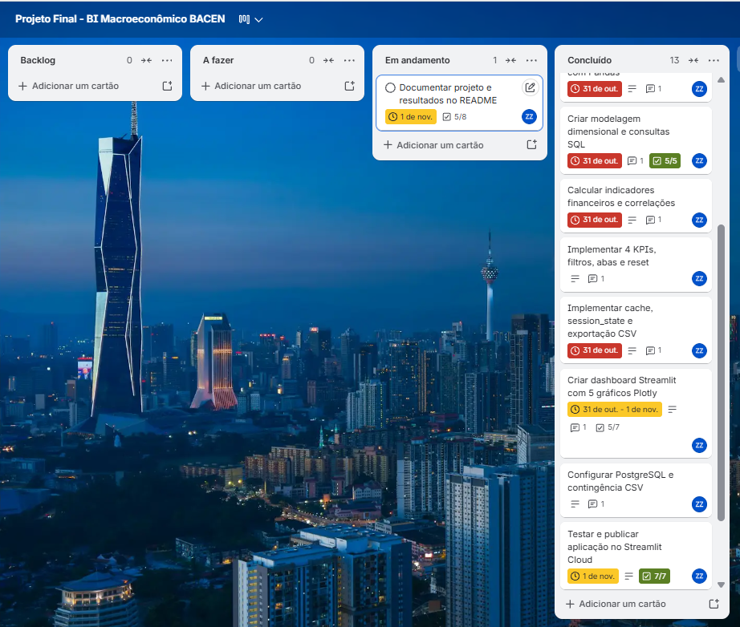

# Projeto Final — Análise de Indicadores Macroeconômicos do Brasil

**Curso:** Visualização de Dados e Business Intelligence — SCTec  
**Aluna:** Zaira Nanci Zatelli Wendt  
**Turma:** 2  
**Período analisado:** 2019 a 2023  

## 1. Sobre o projeto

Este projeto foi desenvolvido como atividade final do curso de Visualização de Dados e Business Intelligence.

O objetivo é analisar indicadores macroeconômicos brasileiros entre 2019 e 2023, utilizando dados públicos do Banco Central do Brasil.

A análise busca compreender o comportamento dos juros, da inflação, do câmbio e da atividade econômica, por meio de consultas SQL, gráficos interativos e indicadores.

## 2. Fonte dos dados

Os dados foram coletados da API SGS do Banco Central do Brasil (BACEN).

Foram utilizadas cinco séries:

| Indicador | Código SGS |
|---|---|
| Selic Meta | 432 |
| IPCA mensal | 433 |
| IPCA acumulado em 12 meses | 13522 |
| Dólar PTAX | 1 |
| IBC-Br dessazonalizado | 24364 |

Fonte: https://dadosabertos.bcb.gov.br/

## 3. Ferramentas utilizadas

- Python e Pandas — coleta, limpeza e preparação dos dados.
- Requests — acesso à API do Banco Central.
- SQLite e SQL — armazenamento e consultas.
- Plotly — criação dos gráficos interativos.
- Streamlit — desenvolvimento do dashboard.
- Git e GitHub — versionamento do projeto.
- Trello — organização das atividades.

## 4. Coleta e tratamento dos dados (ETL)

A coleta e a preparação dos dados foram realizadas no arquivo `src/etl.py`.

As principais etapas foram:

1. Coleta das cinco séries do BACEN.
2. Conversão das datas e dos valores numéricos.
3. Verificação de datas inválidas, valores ausentes e registros duplicados.
4. Padronização dos dados para frequência mensal.
5. Utilização do último valor disponível do mês para as séries diárias, como Selic e dólar.
6. União das cinco séries em uma única base.
7. Criação das colunas de ano, juro real estimado, variação mensal do dólar e IPCA acumulado observado três meses depois.
8. Exportação dos dados tratados para `data/macro_tratado.csv`.

A base final contém **60 registros mensais**, de janeiro de 2019 a dezembro de 2023.

Na validação, não foram identificados valores ausentes nos cinco indicadores principais.

Foram encontrados quatro valores ausentes nas colunas calculadas, considerados esperados:

- Um na variação mensal do dólar, por não existir mês anterior na base.
- Três no IPCA observado três meses depois, porque a base termina em dezembro de 2023.

## 5. Banco de dados e consultas SQL

Foi utilizado o banco SQLite para armazenar os dados tratados.

O banco possui duas tabelas:

- `dim_tempo`: contém data, ano e mês.
- `fato_indicadores`: contém os indicadores econômicos e as colunas calculadas.

Foram criadas cinco consultas SQL para analisar:

1. Indicadores econômicos por mês.
2. Média anual da Selic.
3. Meses em que o dólar ficou acima da média histórica.
4. Comparação entre Selic, IPCA acumulado e juro real estimado.
5. Média anual do IBC-Br.

As duas tabelas foram carregadas com 60 registros cada, e as cinco consultas foram executadas com sucesso.

## 6. Perguntas de negócio

O projeto busca responder às seguintes perguntas:

1. Como a Selic evoluiu entre 2019 e 2023 e em quais momentos o juro real estimado apresentou os maiores valores?
2. Como o dólar PTAX se comportou e em quais períodos ficou acima da média histórica?
3. Existe correlação entre a variação do dólar e a inflação, inclusive considerando três meses de diferença?
4. Como o IBC-Br se comportou durante os períodos de aumento e redução da Selic?
5. Quais indicadores apresentaram as maiores correlações lineares de Pearson?

## 7. Dashboard Streamlit

Foi desenvolvido um dashboard interativo no arquivo `app.py`.

O painel está dividido em quatro abas:

**Aba 1 — Juros e inflação**

Apresenta a evolução da Selic, do IPCA acumulado em 12 meses e do juro real estimado, além dos meses com maiores juros reais e uma análise dos resultados.

**Aba 2 — Câmbio**

Apresenta a trajetória do dólar PTAX, a média histórica do período, um gráfico de dispersão entre dólar e inflação e análises das correlações.

**Aba 3 — Atividade econômica**

Apresenta a evolução do IBC-Br, os maiores e menores valores do indicador e uma análise comparativa com a Selic.

**Aba 4 — Correlações**

Apresenta a matriz de correlação de Pearson, uma tabela com os pares de indicadores, um gráfico de barras e uma interpretação automática da maior correlação absoluta.

## 8. Indicadores estratégicos (KPIs)

O dashboard apresenta quatro indicadores principais:

- Selic Meta.
- IPCA acumulado em 12 meses.
- Juro real estimado.
- Dólar PTAX.

Os indicadores apresentam o valor mais recente do período selecionado e a variação em relação ao registro anterior disponível.

O juro real foi estimado utilizando a fórmula de Fisher, com a Selic Meta e o IPCA acumulado em 12 meses.

## 9. Interatividade

O dashboard permite:

- Filtrar os dados por ano.
- Selecionar um intervalo de datas.
- Escolher as variáveis utilizadas na matriz de correlação.
- Restaurar os filtros.
- Visualizar gráficos e análises atualizados conforme a seleção.
- Baixar os dados filtrados em CSV, com separador e formato decimal adequados ao Excel brasileiro.

## 10. Principais resultados

Durante a análise, foram observados alguns comportamentos importantes:

- O juro real estimado apresentou seu maior valor em junho de 2023, aproximadamente 10,27%.
- O IBC-Br apresentou uma queda acentuada em abril de 2020 e recuperação nos anos seguintes.
- Na análise de 2019 a 2023 com as quatro variáveis principais selecionadas, a maior correlação observada foi entre Selic e IBC-Br, aproximadamente 0,73.
- Os coeficientes de correlação mudaram quando foram selecionados períodos diferentes, demonstrando a importância de considerar o intervalo analisado.

Esses resultados são descritivos e não comprovam relações de causa e efeito.

## 11. Limitações da análise

O projeto possui algumas limitações:

- A análise considera somente o período de 2019 a 2023.
- Os dados foram padronizados para frequência mensal.
- Para séries originalmente diárias, foi utilizado o último valor disponível de cada mês.
- O juro real apresentado é uma estimativa, e não o retorno real efetivamente observado em um investimento.
- As correlações indicam associações estatísticas, mas não comprovam causalidade.
- A comparação do dólar com a inflação três meses depois utiliza valores futuros previamente calculados na base completa.
- A análise utiliza indicadores agregados, sem considerar todos os fatores que podem influenciar a economia.

## 12. Como executar o projeto

Primeiro, é necessário instalar as dependências Python indicadas no arquivo `requirements.txt`.

Na pasta principal do projeto, execute o ETL:

```bash
python -m src.etl
```

Depois, crie e carregue o banco SQLite e execute as consultas:

```bash
python -m src.banco
```

Para iniciar o dashboard:

```bash
streamlit run app.py
```

O dashboard tenta utilizar uma conexão SQL configurada e, caso não esteja disponível, carrega o arquivo local `data/macro_tratado.csv`.


## 13. Organização e versionamento

O desenvolvimento do projeto foi organizado utilizando Trello e GitHub.

No Trello, as atividades foram distribuídas entre as etapas Backlog, A fazer, Em andamento e Concluído, permitindo acompanhar o andamento do projeto.

No GitHub, foram utilizadas branches para separar o desenvolvimento das funcionalidades, as correções e a versão principal da aplicação.

As alterações foram registradas por meio de commits e Pull Requests, utilizando as branches `develop` e `main`.

**Repositório GitHub:** https://github.com/Znanc/projeto-final-indicadores-bacen

**Pull Requests:** https://github.com/Znanc/projeto-final-indicadores-bacen/pulls?q=is%3Apr+is%3Aclosed

**Quadro Trello:** [Projeto Final — BI Macroeconômico BACEN](https://trello.com/b/NCqtPMVQ/projeto-final-bi-macroeconomico-bacen)

**Imagem do Trello:**




## 14. Publicação 

O dashboard foi publicado no Streamlit Community Cloud, utilizando o repositório do GitHub, a branch main e o arquivo app.py.

Aplicação publicada: https://indicadores-macro-bacen.streamlit.app

Após a publicação, foram realizados testes dos filtros, gráficos e indicadores. Também foram feitos ajustes nos nomes dos indicadores para facilitar a leitura das informações.

As alterações foram registradas no GitHub utilizando branches e Pull Requests, seguindo o fluxo de desenvolvimento adotado no projeto.

A aplicação utiliza o arquivo data/macro_tratado.csv como alternativa quando não há conexão com o banco SQL configurada.